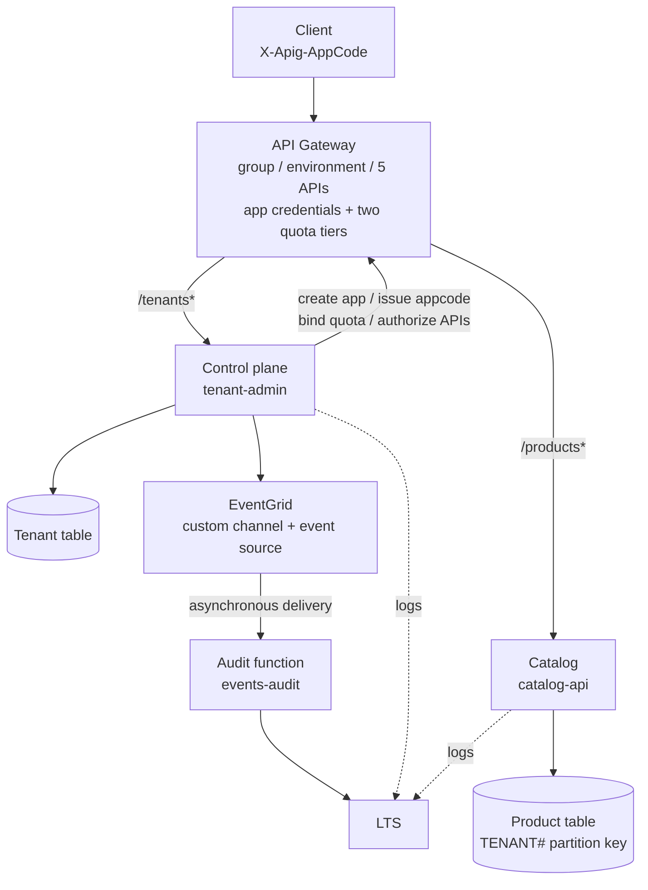

# Multi-Tenant SaaS Control Plane and Product Catalog on FunctionGraph

[](LICENSE)
[](https://www.huaweicloud.com)

Three serverless functions provide the minimum viable multi-tenant control plane: tenant
registration, application credential issuance, quota binding, tenant isolation for a shared product
catalog, and audit trails for lifecycle events. It suits teams that need to validate a multi-tenant
model quickly without first building an identity and quota layer.

## Overview

The hard part of a multi-tenant system is not the business code. It is three questions: **how does
each call resolve to a tenant**, **how do quotas apply per tenant**, and **how is the tenant
lifecycle recorded**. This sample pins down one mechanism for each:

- **Identity** — API Gateway application credentials and appcodes carry the caller identity. At
  tenant registration the control-plane function creates the application, issues the appcode, binds
  the tier quota and authorizes the catalog APIs. A tenant field in the request body never
  participates in authorization.
- **Isolation** — the product table carries an explicit `TENANT#<tenant id>` partition key, so
  isolation is guaranteed by key lookup and a query cannot "forget to filter".
- **Quotas** — two application quotas (basic and standard). Reaching the limit is rejected by the
  gateway with 429; the functions carry no metering logic.
- **Audit** — tenant lifecycle events travel through an EventGrid custom channel to an audit
  function with its own stream and log stream.

**What it solves**: it collapses "multi-tenant control plane from zero to verified" into one
deployment while providing an isolation and quota skeleton reusable in other SaaS scenarios.

**Who it is for**: teams designing a multi-tenant SaaS platform that need to validate the
onboarding flow and isolation boundary, and platform businesses that share one catalog while
requiring tenant data to stay invisible to other tenants.

## Table of Contents

- [Architecture](#architecture)
- [Highlights](#highlights)
- [Cloud Services](#cloud-services)
- [Prerequisites](#prerequisites)
- [Quick Start](#quick-start)
- [Step-by-step Deployment](#step-by-step-deployment)
- [Usage and Verification](#usage-and-verification)
- [Repository Layout](#repository-layout)
- [Clean Up](#clean-up)
- [Further Reading](#further-reading)
- [FAQ](#faq)
- [License](#license)
- [Contact](#contact)

## Architecture



The control plane and the tenant plane are separated by appcode: the admin credential reaches only
the control-plane APIs, and a tenant credential reaches only the catalog APIs.

| Layer | Service | Description |
|-|-|-|
| Ingress | API Gateway dedicated instance | Group + environment + 5 APIs + publications, application auth with appcode |
| Identity and quota | API Gateway applications, appcodes, quotas | Tenant identity and daily call ceiling |
| Compute | FunctionGraph | 3 Python 3.10 functions, 128 MB / 15 s |
| Events | EventGrid | Custom channel + application event source + one subscription |
| Data | Document database (compatible interface) | Tenant and product tables, single-table multi-tenancy |
| Observability | LTS | One log group with three streams |

## Highlights

- **Identity and quota close at the gateway** — once registration finishes, the tenant holds a
  usable appcode and a quota binding, and the business functions keep no session or metering state.
- **Isolation is provable by key** — `TENANT#<tenant id>` is part of the partition key, so a
  cross-tenant read fails at key lookup rather than depending on a correct filter.
- **Onboarding is observable** — the six-step flow runs sequentially inside one invocation; any
  failure writes back a Failed state and returns a precise error.
- **Audit is decoupled** — auditing is driven asynchronously by events, so a delivery failure never
  affects the control-plane response, and the audit trail has its own log stream.
- **Deterministic packaging** — the three packages are produced with fixed timestamps and member
  order, so rebuilds of the same source produce identical digests.
- **Paired inputs validated up front** — shared network plus subnet, and proxy URL plus token, are
  both checked by `check` blocks during plan.

## Cloud Services

| Service | Role in this sample | Terraform resource |
|-|-|-|
| API Gateway | Group, environment, five APIs and publications; application credentials, appcode, application authorization, two quota tiers and quota binding | `huaweicloud_apig_group`, `huaweicloud_apig_environment`, `huaweicloud_apig_api`, `huaweicloud_apig_api_publishment`, `huaweicloud_apig_application`, `huaweicloud_apig_appcode`, `huaweicloud_apig_application_authorization`, `huaweicloud_apig_application_quota`, `huaweicloud_apig_application_quota_associate` |
| FunctionGraph | Control plane, catalog and audit functions | `huaweicloud_fgs_function` |
| EventGrid | Custom channel, application event source, one subscription | `huaweicloud_eg_custom_event_channel`, `huaweicloud_eg_custom_event_source`, `huaweicloud_eg_event_subscription` |
| LTS | One log group and three log streams | `huaweicloud_lts_group`, `huaweicloud_lts_stream` |
| IAM | Three agencies and one custom policy | `huaweicloud_identity_agency`, `huaweicloud_identity_role` |
| Document database (compatible interface) | Tenant and product tables | Initialized by `src/scripts/init_tables.py` |

Release these resources when the sample is no longer needed, to avoid leaving them behind.

## Prerequisites

**Account and permissions**

- An account that has completed real-name verification, with `cn-north-4` available (this sample
  was verified there).
- Permission to enable and operate API Gateway, FunctionGraph, EventGrid, LTS and IAM.
- The agency must grant roles to a cloud service identity: the control-plane agency needs gateway
  management permission and the event target agency needs function invocation permission.
- Access Key ID and Secret Access Key from the "My Credentials" page, supplied to the deployment
  shell. Never write credentials into code or commit them.

**External resources already in place**

- An API Gateway dedicated instance and its instance ID.
- A document database instance (compatible interface) with its data plane address and access key.
- If the data plane is a private address, the network and subnet IDs so functions needing private
  access can be attached.

**Tools and versions**

- Terraform CLI `>= 1.3`, huaweicloud provider `1.96.1`, Python 3.9 or later.

**Region and naming constraints**

- `var.app_name` derives resource names: it must start with a letter, may contain digits and
  hyphens, and is 4 to 31 characters long.
- `var.namespace` determines the physical table names (`<namespace>_tenants`,
  `<namespace>_products`): it must start with a letter, may contain underscores, and is 3 to 31
  characters long.
- Gateway credential and quota names reject hyphens; the implementation normalizes them to
  underscores.

## Quick Start

```bash
# 1. Build the three packages (offline)
python src/scripts/build.py

# 2. Local checks
cd src && python -m pytest tests -q && cd ..
cd infra && terraform init && terraform validate && cd ..

# 3. Supply deployment values and create resources
cd infra
export HW_ACCESS_KEY=<HW_ACCESS_KEY>
export HW_SECRET_KEY=<HW_SECRET_KEY>
export TF_VAR_apig_instance_id="<API Gateway dedicated instance ID>"
export TF_VAR_gemini_db_endpoint="<data plane address>"
export TF_VAR_gemini_db_access_key="<data plane access key ID>"
export TF_VAR_gemini_db_secret_key="<data plane secret access key>"
terraform plan -out=mtsaas.tfplan
terraform apply mtsaas.tfplan

# 4. Initialize the tables and verify
cd ..
python src/scripts/init_tables.py
python src/scripts/verify_e2e.py
```

## Step-by-step Deployment

### Step 1: Build the packages

```bash
python src/scripts/build.py
```

Expected output (three packages; digests change with the source):

```text
{
  "tenant_admin": {"bytes": 7329, "file": "src/build/tenant_admin.zip", "sha256": "e5d2c5cb…"},
  "catalog_api": {...},
  "events_audit": {...}
}
```

The ZIP roots hold the handler files directly, and the entry is `<filename>.handler`, matching the
`handler` values in `infra/main.tf`.

### Step 2: Local checks

```bash
cd src
python -m pytest tests -q
cd ..
```

Expected output:

```text
3 passed in 0.03s
```

```bash
cd infra
terraform init
terraform validate
```

Expected output:

```text
Success! The configuration is valid, but there were some
validation warnings as shown above.
```

### Step 3: Supply deployment values

```bash
export HW_ACCESS_KEY=<HW_ACCESS_KEY>
export HW_SECRET_KEY=<HW_SECRET_KEY>
export TF_VAR_apig_instance_id="<API Gateway dedicated instance ID>"
export TF_VAR_gemini_db_endpoint="<data plane address>"
export TF_VAR_gemini_db_access_key="<data plane access key ID>"
export TF_VAR_gemini_db_secret_key="<data plane secret access key>"
```

Optional values (the full list is in `infra/variables.tf`):

| Variable | Default | Description |
|-|-|-|
| `region` | `cn-north-4` | Deployment region |
| `app_name` | `mtsaas` | Resource name prefix |
| `namespace` | `mtsaas` | Table namespace |
| `apig_env_name` | `prod` | Publication environment (used only when the sample creates its own) |
| `shared_apig_env_id` | empty | Existing shared environment |
| `shared_network_id` / `shared_subnet_id` | empty | Network and subnet for the functions, set as a pair |
| `basic_quota_limit` / `standard_quota_limit` | `50` / `100` | Daily call quotas for the two tiers |

### Step 4: Initialize the tables

```bash
python src/scripts/init_tables.py
```

Expected output:

```text
[INFO] table <namespace>_tenants ready
[INFO] table <namespace>_products ready
```

The script is idempotent and safe to re-run.

### Step 5: Create resources

```bash
cd infra
terraform plan -out=mtsaas.tfplan
terraform apply mtsaas.tfplan
```

Expected output:

```text
Plan: 27 to add, 0 to change, 0 to destroy.
Apply complete! Resources: 27 added, 0 changed, 0 destroyed.
```

### Step 6: Read the outputs

```bash
terraform output
```

The admin appcode is sensitive and must be read explicitly:

```bash
terraform output -raw admin_appcode
```

## Usage and Verification

### Minimal example: register a tenant and write one product

```bash
export BASE="$(terraform output -raw api_base_url)"
export STAGE="$(terraform output -raw api_stage)"
export APPCODE="$(terraform output -raw admin_appcode)"

curl -X POST "$BASE/tenants" -H "X-Stage: $STAGE" -H "X-Apig-AppCode: $APPCODE" \
  -H "Content-Type: application/json" \
  -d '{"name":"acme","tier":"basic"}'
```

Expected 201 with a tenant view that includes the tenant appcode:

```json
{"tenantId":"<tenant id>","name":"acme","tier":"basic","status":"Active","appcode":"<tenant appcode>"}
```

Write a product with that appcode:

```bash
export TENANT_CODE="<tenant appcode>"

curl -X POST "$BASE/products" -H "X-Stage: $STAGE" -H "X-Apig-AppCode: $TENANT_CODE" \
  -H "Content-Type: application/json" \
  -d '{"sku":"SKU-1","name":"sample product","price":99}'
```

Expected 201.

### Run all read-only probes at once

```bash
python src/scripts/verify_e2e.py
```

Expected tail:

```text
[PASS] cloud-probe verification completed
```

Five probes check that the control plane is readable, that a control-plane call without a
credential is rejected, that a catalog call without a credential is rejected, that the admin
credential is rejected by the catalog API, and that a missing tenant returns 404. The probes create
no tenants or credentials, so nothing is left on the shared instance.

### Verify tenant isolation

Register a second tenant, then read tenant B's product with tenant A's appcode:

```bash
curl -o /dev/null -w "%{http_code}\n" "$BASE/products/<tenant B product id>" \
  -H "X-Stage: $STAGE" -H "X-Apig-AppCode: $TENANT_A_CODE"
```

Expected 404 — the catalog isolates by the key prefix derived from the tenant resolved from the
appcode, so a cross-tenant read fails at key lookup.

### Verify quota enforcement

Lower the basic quota to a small value and re-apply, then call the catalog API repeatedly with a
basic-tier tenant:

```bash
terraform apply -var="basic_quota_limit=2"
```

Once the ceiling is hit the gateway returns 429 directly:

```text
< HTTP/1.1 429 Too Many Requests
```

The quota uses a daily window; recovery needs the next window or a new quota value.

### Verify event delivery and audit

```bash
terraform output events_audit_log_stream_id
```

A successful tenant registration publishes one lifecycle event. Search that log stream ID in the
LTS console; you should see the event identifier, type, source and full content. The first delivery
may be delayed by authorization propagation.

**After deployment, run the steps in this section in your own environment and confirm the features
work before treating the delivery as complete.**

## Repository Layout

```text
.
├── README.md
├── README.en.md
├── LICENSE
├── docs/
│   ├── architecture.md          Multi-tenant model, data flow and trade-offs
│   └── deployment-guide.md      Step-by-step commands with expected output
├── infra/
│   ├── versions.tf              Terraform and provider version constraints
│   ├── variables.tf             Input variables and paired validations
│   ├── main.tf                  Logs, agencies, functions, EventGrid, gateway and quotas
│   └── outputs.tf               Outputs
└── src/
    ├── tenant_admin.py          Control-plane function (register / list / read / status)
    ├── catalog_api.py           Catalog function (product CRUD)
    ├── events_audit.py          Audit function (event consumption)
    ├── scripts/
    │   ├── build.py             Deterministic packaging
    │   ├── init_tables.py       Table initialization
    │   └── verify_e2e.py        Post-deployment read-only probes
    ├── tests/test_logic.py      Unit tests
    └── build/                   Package artifacts (generated)
```

## Clean Up

```bash
cd infra
terraform destroy
```

Expected output:

```text
Destroy complete! Resources: 27 destroyed.
```

Destroy removes the functions, group/environment/APIs/publications, application credential and
appcode, both quota tiers, the event channel and subscription, the log group and streams, and the
three agencies plus the custom policy.

The data tables and the API Gateway instance are shared resources and outside this directory's
cleanup scope. To clear this namespace's data:

```bash
python src/scripts/init_tables.py --drop
```

That command touches only tables in this namespace.

## Further Reading

- Multi-tenant model, end-to-end data flow and trade-offs: [docs/architecture.md](docs/architecture.md)
- Complete commands from zero to a verified deployment: [docs/deployment-guide.md](docs/deployment-guide.md)
- Chinese edition: [README.md](README.md)

## FAQ

**A call returns 401.**
The `X-Apig-AppCode` header is missing, or the credential is not authorized for the target
environment. The admin credential is authorized only for control-plane APIs and is rejected by the
catalog API by design.

**A valid path returns 404.**
First check for the `X-Stage` header, then confirm the path prefix (`/tenants` and `/products` are
two separate API sets).

**Registration returns 403.**
The control-plane agency lacks gateway management permission, or the role was granted at the wrong
scope (it must be project level).

**Registration returns 500.**
Check the control-plane function logs for the failing step. The onboarding flow writes back a Failed
state on failure, and repeating the call for the same tenant returns a conflict.

**A catalog request returns 403.**
The tenant is not in the `Active` state, or the appcode is not bound to a quota.

**Events are not delivered.**
The event `source` field must match the registered event source name. Authorization propagation
after subscription creation takes time; retry after a short wait.

**429 keeps coming back.**
The quota uses a daily window. Re-apply after changing the quota value; the used count does not
reset within the window.

## License

This sample is released under the MIT No Attribution license. See [LICENSE](LICENSE).

## Contact

Created and maintained by: Public Cloud Continuous Operations Department.

Please open an issue in this repository if you run into problems; we review them regularly.
