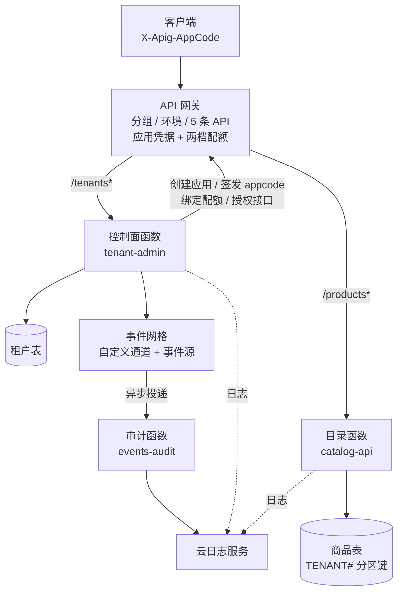

# 基于函数计算的多租户 SaaS 控制面与商品目录实践

[](LICENSE)
[](https://www.huaweicloud.com)

用三个无服务器函数搭出一套多租户 SaaS 的最小控制面：租户注册、应用凭据签发、调用配额绑定、
共享商品目录的租户隔离，以及生命周期事件的审计留痕。适用于需要快速验证多租户模型、
又不想先自建身份与配额体系的团队。

## 简介

多租户系统的难点不在业务代码，而在三件事：**每次调用怎么定位租户**、**配额怎么按租户生效**、
**租户的完整生命周期怎么留痕**。这套实践把三件事各用一个明确机制固定下来：

- **身份**：以 API 网关的应用凭据与 appcode 承载调用身份。租户注册时由控制面函数动态创建应用、
  签发 appcode、绑定档位配额并授权目录接口；请求体里的租户字段一律不参与授权判断。
- **隔离**：商品表显式带 `TENANT#<租户标识>` 分区键，隔离由存储层的键定位保证，
  查询不可能「忘记过滤」。
- **配额**：两档应用配额（基础档 / 标准档），达到上限由网关直接返回 429，函数不承担计量逻辑。
- **留痕**：租户生命周期事件经事件网格自定义通道投递到审计函数，审计独立成流、独立日志。

**解决的问题**：把「多租户控制面从零到可验证」压缩成一次部署，同时给出可复制到其它 SaaS 场景的隔离与配额骨架。

**适用于**：正在设计多租户 SaaS 平台、需要验证租户入驻流程与隔离边界的团队；
以及需要共享一套商品目录、但要求租户数据互不可见的平台型业务。

## 目录

- [架构图](#架构图)
- [方案亮点](#方案亮点)
- [涉及云服务](#涉及云服务)
- [前置条件](#前置条件)
- [快速开始](#快速开始)
- [分步部署](#分步部署)
- [使用方法与验证](#使用方法与验证)
- [仓库结构](#仓库结构)
- [清理资源](#清理资源)
- [详细说明](#详细说明)
- [常见问题](#常见问题)
- [许可证](#许可证)
- [联系方式](#联系方式)

## 架构图



控制面与租户面通过不同的 appcode 区分权限：管理端凭据只能访问控制面 API，租户凭据只能访问目录 API。

| 层次 | 承担的服务 | 说明 |
|-|-|-|
| 入口 | API 网关专享实例 | 分组 + 环境 + 5 条 API + 发布，应用认证与 appcode 简单认证 |
| 身份与配额 | API 网关应用 / appcode / 应用配额 | 租户身份与按天调用上限 |
| 计算 | 函数计算 | 3 个 Python 3.10 函数，128 MB / 15 秒 |
| 事件 | 事件网格 | 自定义通道 + 应用类事件源 + 单条订阅 |
| 数据 | 文档数据库（兼容接口） | 租户表与商品表，单表多租户 |
| 观测 | 云日志服务 | 一个日志组与三条日志流 |

## 方案亮点

- **身份与配额都在网关侧闭环**：租户注册完成后立刻拿到可用的 appcode 与配额绑定，
  业务函数不需要维护会话或计量状态。
- **租户隔离可由键证明**：`TENANT#<租户标识>` 进入分区键，跨租户读取在键定位阶段即失败，
  不依赖查询条件正确性。
- **入驻流程可观测**：六步入驻在单次执行内顺序完成，任一步失败写回 Failed 状态并返回明确错误。
- **审计与主链路解耦**：审计由事件异步驱动，投递失败不影响控制面响应，审计有独立日志流。
- **确定性打包**：三个部署包以固定时间戳与固定成员顺序产出，重复构建摘要一致。
- **两处成对校验前置**：共享网络与子网、数据面代理地址与令牌，均在计划阶段由 `check` 块校验。

## 涉及云服务

| 云服务 | 本实践中的职责 | 对应 Terraform 资源 |
|-|-|-|
| API 网关 | 分组、环境、五条 API 与发布；应用凭据、appcode、应用授权、两档配额与配额绑定 | `huaweicloud_apig_group`、`huaweicloud_apig_environment`、`huaweicloud_apig_api`、`huaweicloud_apig_api_publishment`、`huaweicloud_apig_application`、`huaweicloud_apig_appcode`、`huaweicloud_apig_application_authorization`、`huaweicloud_apig_application_quota`、`huaweicloud_apig_application_quota_associate` |
| 函数计算 | 控制面、目录面与审计三个函数 | `huaweicloud_fgs_function` |
| 事件网格 | 自定义通道、应用类事件源、单条订阅 | `huaweicloud_eg_custom_event_channel`、`huaweicloud_eg_custom_event_source`、`huaweicloud_eg_event_subscription` |
| 云日志服务 | 一个日志组与三条日志流 | `huaweicloud_lts_group`、`huaweicloud_lts_stream` |
| 统一身份认证服务 | 三个委托与一个自定义策略 | `huaweicloud_identity_agency`、`huaweicloud_identity_role` |
| 文档数据库（兼容接口） | 租户表与商品表 | 由 `src/scripts/init_tables.py` 初始化 |

确认不再需要本实践后，及时释放上述资源，避免残留。

## 前置条件

**账号与权限**

- 已开通账号并完成实名认证，可用区域为 `cn-north-4`（本实践在该区域验证）。
- 具备 API 网关、函数计算、事件网格、云日志服务与统一身份认证的开通与操作权限。
- 委托需要把角色授予云服务身份：控制面委托需网关管理面权限，事件目标委托需函数调用权限。
- 在「我的凭证」页面获取 Access Key ID 与 Secret Access Key，填入部署脚本；
  不要把凭据写入代码或提交到仓库。

**已就绪的外部资源**

- 一个 API 网关专享实例，记录其实例 ID。
- 一个文档数据库实例（兼容接口）及其数据面地址与访问密钥。
- 数据面若为私网地址，需准备网络与子网 ID，并把需要访问私网的函数挂接上去。

**工具与版本**

- Terraform CLI `>= 1.3`，huaweicloud Provider `1.96.1`，Python 3.9 及以上。

**区域与命名约束**

- `var.app_name` 决定资源名，须字母开头、可含数字与连字符、长度 4~31。
- `var.namespace` 决定物理表名（`<namespace>_tenants`、`<namespace>_products`），
  须字母开头、可含下划线、长度 3~31。
- 网关侧的凭据名与配额名不允许连字符，实现里已统一下划线。

## 快速开始

```bash
# 1. 构建三个部署包（离线）
python src/scripts/build.py

# 2. 本地校验
cd src && python -m pytest tests -q && cd ..
cd infra && terraform init && terraform validate && cd ..

# 3. 填写部署参数并创建资源
cd infra
export HW_ACCESS_KEY=<HW_ACCESS_KEY>
export HW_SECRET_KEY=<HW_SECRET_KEY>
export TF_VAR_apig_instance_id="<APIG 专享实例 ID>"
export TF_VAR_gemini_db_endpoint="<数据面地址>"
export TF_VAR_gemini_db_access_key="<数据面访问密钥 ID>"
export TF_VAR_gemini_db_secret_key="<数据面访问密钥 Secret>"
terraform plan -out=mtsaas.tfplan
terraform apply mtsaas.tfplan

# 4. 初始化数据表并验证
cd ..
python src/scripts/init_tables.py
python src/scripts/verify_e2e.py
```

## 分步部署

### 第 1 步：构建部署包

```bash
python src/scripts/build.py
```

预期输出（三个包，摘要随源码变化）：

```text
{
  "tenant_admin": {"bytes": 7329, "file": "src/build/tenant_admin.zip", "sha256": "e5d2c5cb…"},
  "catalog_api": {...},
  "events_audit": {...}
}
```

ZIP 根目录直接放处理文件，入口为 `<文件名>.handler`，与 `infra/main.tf` 的 `handler` 取值一致。

### 第 2 步：本地校验

```bash
cd src
python -m pytest tests -q
cd ..
```

预期输出：

```text
3 passed in 0.03s
```

```bash
cd infra
terraform init
terraform validate
```

预期输出：

```text
Success! The configuration is valid, but there were some
validation warnings as shown above.
```

### 第 3 步：填写部署参数

```bash
export HW_ACCESS_KEY=<HW_ACCESS_KEY>
export HW_SECRET_KEY=<HW_SECRET_KEY>
export TF_VAR_apig_instance_id="<APIG 专享实例 ID>"
export TF_VAR_gemini_db_endpoint="<数据面地址>"
export TF_VAR_gemini_db_access_key="<数据面访问密钥 ID>"
export TF_VAR_gemini_db_secret_key="<数据面访问密钥 Secret>"
```

可选参数（完整清单见 `infra/variables.tf`）：

| 变量 | 默认值 | 说明 |
|-|-|-|
| `region` | `cn-north-4` | 部署区域 |
| `app_name` | `mtsaas` | 资源名称前缀 |
| `namespace` | `mtsaas` | 表命名空间 |
| `apig_env_name` | `prod` | 发布环境名（仅自建环境时生效） |
| `shared_apig_env_id` | 空 | 已有共享环境 ID |
| `shared_network_id` / `shared_subnet_id` | 空 | 函数挂接的网络与子网，成对填写 |
| `basic_quota_limit` / `standard_quota_limit` | `50` / `100` | 两档每日调用配额 |

### 第 4 步：初始化数据表

```bash
python src/scripts/init_tables.py
```

预期输出：

```text
[INFO] table <namespace>_tenants ready
[INFO] table <namespace>_products ready
```

脚本幂等，重复执行无副作用。

### 第 5 步：创建资源

```bash
cd infra
terraform plan -out=mtsaas.tfplan
terraform apply mtsaas.tfplan
```

预期输出：

```text
Plan: 27 to add, 0 to change, 0 to destroy.
Apply complete! Resources: 27 added, 0 changed, 0 destroyed.
```

### 第 6 步：查看部署输出

```bash
terraform output
```

管理端 appcode 为敏感值，需要显式取值：

```bash
terraform output -raw admin_appcode
```

## 使用方法与验证

### 最简示例：注册一个租户并写入一件商品

```bash
export BASE="$(terraform output -raw api_base_url)"
export STAGE="$(terraform output -raw api_stage)"
export APPCODE="$(terraform output -raw admin_appcode)"

curl -X POST "$BASE/tenants" -H "X-Stage: $STAGE" -H "X-Apig-AppCode: $APPCODE" \
  -H "Content-Type: application/json" \
  -d '{"name":"acme","tier":"basic"}'
```

预期返回 201 与租户视图，其中包含该租户的 appcode：

```json
{"tenantId":"<租户标识>","name":"acme","tier":"basic","status":"Active","appcode":"<租户 appcode>"}
```

用该 appcode 写入一件商品：

```bash
export TENANT_CODE="<租户 appcode>"

curl -X POST "$BASE/products" -H "X-Stage: $STAGE" -H "X-Apig-AppCode: $TENANT_CODE" \
  -H "Content-Type: application/json" \
  -d '{"sku":"SKU-1","name":"示例商品","price":99}'
```

预期返回 201。

### 一次跑完只读探针校验

```bash
python src/scripts/verify_e2e.py
```

预期输出结尾：

```text
[PASS] cloud-probe verification completed
```

五项探针覆盖：控制面可读、控制面缺凭据被拒、目录缺凭据被拒、
管理端凭据访问目录被拒、缺失租户返回 404。探针不创建租户或凭据，结束后共享实例上无残留。

### 验证租户隔离

再用第二个租户注册，然后用租户甲的 appcode 读取租户乙的商品：

```bash
curl -o /dev/null -w "%{http_code}\n" "$BASE/products/<租户乙的商品标识>" \
  -H "X-Stage: $STAGE" -H "X-Apig-AppCode: $TENANT_A_CODE"
```

预期返回 404——目录按 appcode 反查到的租户做键前缀隔离，跨租户读取在键定位阶段即失败。

### 验证配额生效

把基础档配额调到很小（例如 2）后重新应用，再用基础档租户连续调用目录接口：

```bash
terraform apply -var="basic_quota_limit=2"
```

达到上限后网关直接返回 429：

```text
< HTTP/1.1 429 Too Many Requests
```

配额为按天窗口，恢复需等下一窗口或重新调整配额值。

### 验证事件投递与审计

```bash
terraform output events_audit_log_stream_id
```

租户注册成功后会发布一条生命周期事件。在云日志服务控制台按该日志流 ID 检索，
预期看到事件标识、类型、来源与完整内容。首次投递可能因授权传播而延迟。

**部署完成后请按本节步骤在真实环境自行验证，确认功能可用后方可视为交付完成。**

## 仓库结构

```text
.
├── README.md
├── README.en.md
├── LICENSE
├── docs/
│   ├── architecture.md          多租户模型、数据流与关键设计取舍
│   └── deployment-guide.md      分步部署命令与每步预期输出
├── infra/
│   ├── versions.tf              Terraform 与 Provider 版本约束
│   ├── variables.tf             输入变量与成对校验
│   ├── main.tf                  日志、委托、函数、事件网格、网关与配额
│   └── outputs.tf               对外输出
└── src/
    ├── tenant_admin.py          控制面函数（注册 / 列表 / 查询 / 状态变更）
    ├── catalog_api.py           目录函数（商品 CRUD）
    ├── events_audit.py          审计函数（事件消费）
    ├── scripts/
    │   ├── build.py             确定性打包
    │   ├── init_tables.py       表初始化
    │   └── verify_e2e.py        部署后只读探针
    ├── tests/test_logic.py      单元测试
    └── build/                   部署包产物（构建生成）
```

## 清理资源

```bash
cd infra
terraform destroy
```

预期输出：

```text
Destroy complete! Resources: 27 destroyed.
```

销毁会删除函数、分组/环境/API/发布、应用凭据与 appcode、两档配额、事件通道与订阅、
日志组与日志流、三个委托与自定义策略。

数据表与网关专享实例属共享资源，不在本目录的清理范围。需要清空本命名空间的数据时执行：

```bash
python src/scripts/init_tables.py --drop
```

该命令只作用于本命名空间的表。

## 详细说明

- 多租户模型、端到端数据流与关键设计取舍：[docs/architecture.md](docs/architecture.md)
- 从零到可验证部署的完整命令与预期输出：[docs/deployment-guide.md](docs/deployment-guide.md)
- 英文版说明：[README.en.md](README.en.md)

## 常见问题

**调用返回 401。**
缺少 `X-Apig-AppCode` 请求头，或该凭据未被授权到目标环境。管理端凭据只授权到控制面 API，
访问目录 API 会被拒绝——这是设计行为。

**调用返回 404 但路径是对的。**
先确认是否遗漏 `X-Stage` 请求头；再确认路径前缀（`/tenants` 与 `/products` 是两组不同 API）。

**注册返回 403。**
控制面委托缺少网关管理面权限，或角色授错了层级（需按项目级挂载）。

**注册返回 500。**
查看控制面函数日志定位失败步骤。入驻流程会在失败时写回 Failed 状态，
重复调用同一租户会返回冲突。

**目录请求返回 403。**
租户状态不是 `Active`，或 appcode 未绑定配额。

**事件没有投递。**
事件 `source` 字段必须与注册的事件源同名；订阅创建后授权传播需要时间，稍候重试。

**持续收到 429。**
配额为按天窗口。调整配额值后需重新应用；已用计数在窗口内不回落。

## 许可证

本实践采用 MIT No Attribution 许可证发布，详见 [LICENSE](LICENSE)。

## 联系方式

创建与维护团队：公有云持续运营部。

使用中遇到问题请在本仓库提交议题，我们会定期查看。
