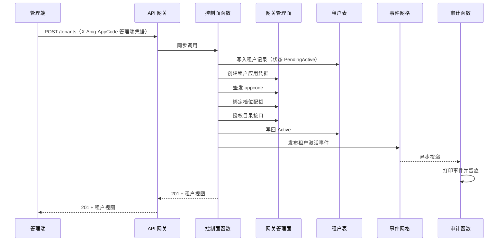
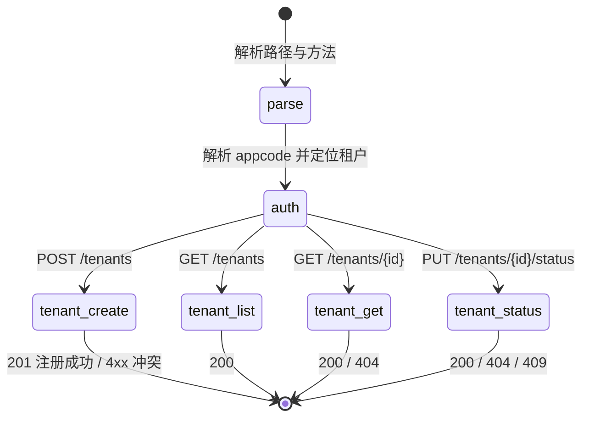
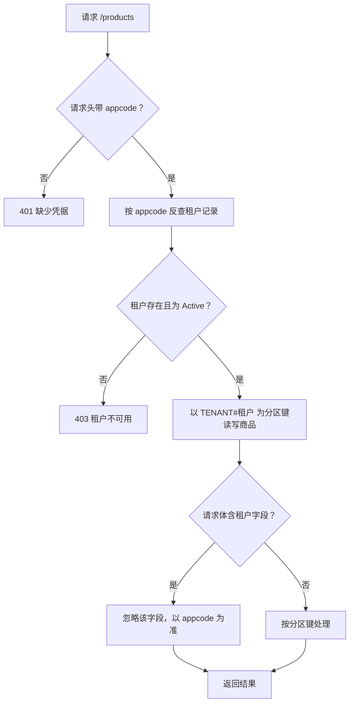

# 架构与技术设计

本文说明本实践的多租户架构组成、端到端数据流与关键设计取舍。
部署命令见 [deployment-guide.md](deployment-guide.md)，功能概览见仓库根目录 `README.md`。

## 1. 分层与职责

| 层 | 职责 | 落地位置 |
|-|-|-|
| 入口层 | 控制面与租户面两组 HTTP 路由，按应用凭据鉴权 | `infra/main.tf` 的分组、环境、5 条 API 与发布记录 |
| 控制面 | 租户注册、查询、状态变更，以及入驻流程编排 | `src/tenant_admin.py` |
| 租户面 | 共享商品目录，按租户键前缀隔离数据 | `src/catalog_api.py` |
| 审计面 | 消费生命周期事件并留痕 | `src/events_audit.py` |
| 数据层 | 租户表与商品表的读写 | 三个函数内的兼容接口客户端 |
| 观测层 | 三条运行日志流 | `infra/main.tf` 的日志组与日志流 |

## 2. 组件清单

### 2.1 三个函数（`infra/main.tf`）

| 组件 | 运行时 / 规格 | 职责 |
|-|-|-|
| `tenant-admin` | Python 3.10 / 128 MB / 15 秒 | 控制面四条路由；入驻流程在单次执行内顺序完成 |
| `catalog-api` | Python 3.10 / 128 MB / 15 秒 | 商品目录五条路由；从请求头解析租户 |
| `events-audit` | Python 3.10 / 128 MB / 15 秒 | 事件网格订阅目标，打印事件与完整内容 |

三个函数均绑定日志组 ID/名称与日志流 ID/名称四个参数，部署包由 `src/scripts/build.py`
以固定时间戳与固定成员顺序产出。

### 2.2 入口与身份（`infra/main.tf`）

| 方法 | 路径 | 后端 | 鉴权 |
|-|-|-|-|
| ANY | `/tenants` | tenant-admin | 应用认证 + appcode 简单认证 |
| ANY | `/tenants/{tenant_id}` | tenant-admin | 同上 |
| ANY | `/tenants/{tenant_id}/status` | tenant-admin | 同上 |
| ANY | `/products` | catalog-api | 同上 |
| ANY | `/products/{product_id}` | catalog-api | 同上 |

- 管理端应用凭据与 appcode 随部署创建，并以应用授权绑定到三条控制面 API。
- 租户应用凭据与 appcode 在租户注册时由控制面函数动态创建，再绑定档位配额与目录接口授权。
- 请求头固定为 `X-Apig-AppCode`；环境由请求头 `X-Stage` 指定。

### 2.3 配额（`infra/main.tf`）

两档应用配额，均为 1 天窗口：基础档与标准档各一个。管理端凭据绑定标准档；
租户注册时由控制面函数把新应用绑定到请求体声明的档位。超限由网关直接返回 429。

### 2.4 事件与数据

- 事件网格：1 个自定义通道、1 个应用类事件源、1 条订阅（目标为审计函数，异步投递）。
  发布事件时 `source` 字段必须与注册事件源同名，否则不投递。
- 数据：租户表以租户标识为主键；商品表显式带 `TENANT#<租户标识>` 分区键。
  两张表由 `src/scripts/init_tables.py` 幂等初始化，函数经兼容接口的 JSON 协议访问。

## 3. 端到端数据流

### 3.1 租户入驻的完整时序

任一步失败时写回 Failed 状态并返回错误，已创建的应用凭据由后续清理动作处理。

### 3.2 控制面状态机

### 3.3 目录请求的租户隔离

请求体中的租户字段一律不参与授权判断，租户归属只由 appcode 反查结果决定。

### 3.4 云侧调用面

| 调用面 | 用途 | 备注 |
|-|-|-|
| 网关管理面 | 创建应用凭据、签发 appcode、绑定配额、授权接口 | 同一区域的令牌认证 |
| 事件网格 | 发布生命周期事件 | `source` 必须与事件源同名 |
| 兼容接口 | 租户表与商品表读写 | JSON 协议 + 请求签名 |

## 4. 运行期配置契约

函数的环境配置由 `local.gemini_env` 与各自的补充项合并而成，键名不新造。

| 键 | 使用者 | 用途 |
|-|-|-|
| `GEMINI_ENDPOINT` / `PORT` / `PROTOCOL` / `REGION` | 三个函数 | 数据面地址与签名区域 |
| `GEMINI_ACCESS_KEY` / `GEMINI_SECRET_KEY` | 三个函数 | 数据面凭据（敏感） |
| `REGION` / `PROJECT_ID` | 控制面函数 | 管理面调用与资源路径 |
| `APP_NAME_UNDERSCORE` | 控制面函数 | 应用与配额命名 |
| `APIG_INSTANCE_ID` / `APIG_ENV_ID` | 控制面函数 | 管理面作用域 |
| `CATALOG_API_IDS` | 控制面函数 | 授权目录接口 |
| `BASIC_QUOTA_ID` / `STANDARD_QUOTA_ID` | 控制面函数 | 档位配额绑定 |
| `EG_CHANNEL_ID` / `EG_SOURCE_NAME` | 控制面函数 | 事件发布 |
| `TENANT_TABLE` / `PRODUCT_TABLE` | 三个函数 | 表名 |

两处可选配置：共享网络与子网必须成对提供（否则函数不挂接网络）；
数据面代理地址与令牌必须成对提供（否则保持直连签名路径）。两处均以 `check` 块在计划阶段校验。

## 5. 关键设计取舍

### 5.1 为什么用应用凭据承载租户身份

多租户系统的核心是「每次调用都能定位到一个确定租户」。应用凭据与 appcode 满足三点：
凭据可按租户独立签发与吊销、调用配额可按键绑定、网关侧可对未授权调用直接拒绝。
控制面因此不需要在业务代码里维护会话，也不必在请求体里信任租户字段。

### 5.2 为什么入驻流程放在函数内顺序执行

入驻涉及六步跨服务写操作，其中任何一步都可能失败。用一个函数顺序执行的好处是：
失败点明确、状态回写与错误返回在同一事务边界内、无需额外的编排服务与执行历史。
代价是缺少可视化编排与平台级重试，重试由调用方按幂等语义发起。

### 5.3 为什么两档配额用应用配额而不是限流规则

配额需要「按租户、按天」累计，且要在网关侧直接拒绝而非进入函数。
应用配额天然绑定应用凭据，达到上限由网关返回 429，函数侧无需感知计量逻辑。
换档位只需改绑不同的配额对象。

### 5.4 为什么商品表要显式带租户分区键

单表多租户最常见的失误是把租户过滤写成查询条件而不是键的一部分。
把 `TENANT#<租户标识>` 放进分区键后，隔离由存储层的键定位保证，
查询不可能「忘记过滤」，也便于按租户统计容量。

### 5.5 为什么事件通道与事件源要分开注册

发布事件时 `source` 字段必须与注册的事件源同名，投递才会发生。
把通道、事件源、订阅三者分开声明，可以让「谁能发布」与「发到哪里」解耦：
新增发布方只需注册新事件源，订阅侧不必改动。

### 5.6 为什么审计独立成一个函数

审计是事件投递的落点，与主链路解耦。独立后有三个好处：
事件投递失败不会影响控制面响应、审计可以独立伸缩、审计日志有独立的日志流便于检索。
订阅创建后需等待授权传播，首次投递可能延迟。

## 6. 扩展点

- **加档位**：新增一个应用配额资源，并在控制面函数的档位映射里注册。
- **加控制面动作**：在 `local.control_routes` 增加一项，并在 `src/tenant_admin.py` 的路由分支里处理。
- **换数据隔离粒度**：改商品表的分区键构造（`src/catalog_api.py` 与 `src/tenant_admin.py` 各一处）。
- **接第三方身份提供方**：在控制面函数里把 appcode 解析替换为令牌校验，路由与配额不变。
- **加审计出口**：在审计函数里增加下游写入，订阅侧无需改动。
